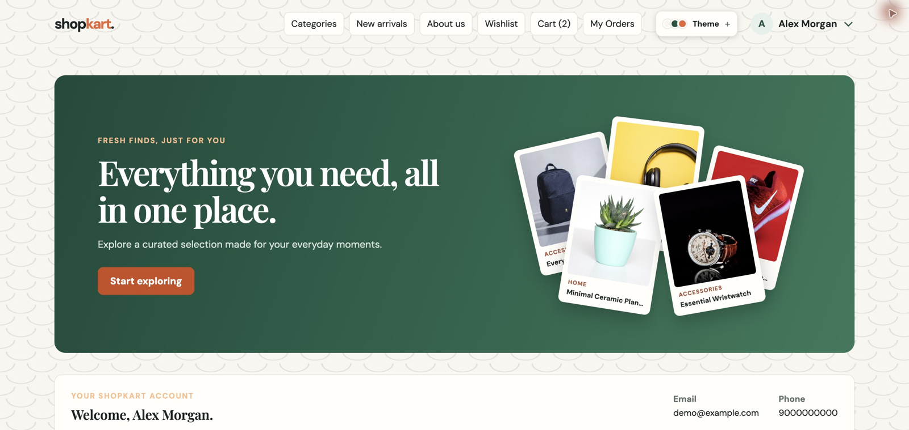
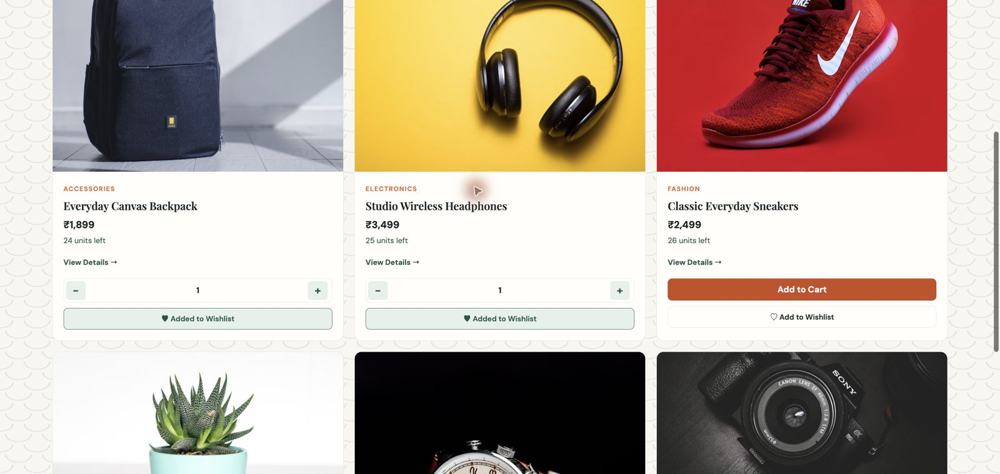
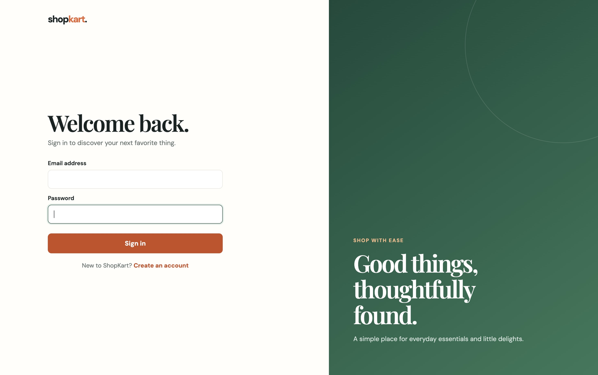
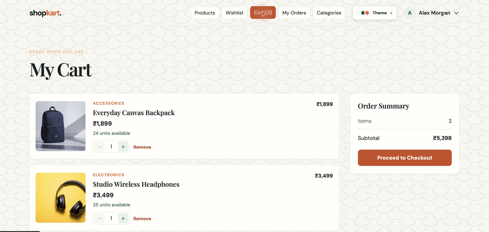
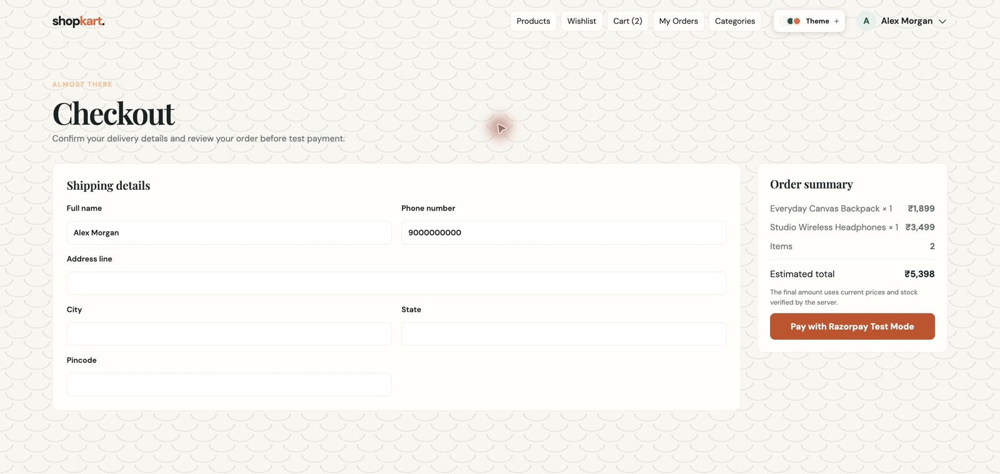
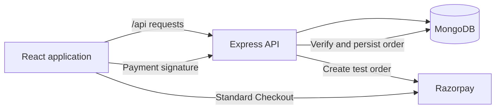

<div align="center">

# ShopKart

### Everyday essentials. A thoughtfully built shopping experience.

A full-stack e-commerce application with product discovery, personal wishlists,<br />
a persistent cart, and Razorpay Test Mode checkout.


[Live app](https://shopkart-mu-lime.vercel.app) · [Explore the app](#a-look-inside) · [Run locally](#getting-started) · [API reference](#api-reference) · [Project structure](#project-structure) · [Deploy on Vercel](docs/DEPLOYMENT.md)



</div>

## Overview

ShopKart brings the shopping journey into one cohesive application: create an account, discover products, save favorites, manage quantities, and place an order through a verified test payment. A warm cream palette, green accents, editorial typography, and eight selectable themes give the interface its character.

Built as an engineering lab project, the repository includes both the React client and the Express API, with MongoDB persistence for customers, products, carts, wishlists, and orders.

## Live deployment

**[Visit ShopKart →](https://shopkart-mu-lime.vercel.app)**

The React frontend and Express API run together on Vercel, backed by MongoDB Atlas. Browser navigation and `/api` requests share one HTTPS origin.

| Deployment | Details |
| --- | --- |
| Application | [shopkart-mu-lime.vercel.app](https://shopkart-mu-lime.vercel.app) |
| API health | [/api/health](https://shopkart-mu-lime.vercel.app/api/health) |
| Runtime | Node.js 24 on Vercel |
| Payments | Razorpay **Test Mode** |
| Last verified | 15 October 2026 |

Production checks covered registration, login, secure cookies, product search, wishlists, cart persistence, and order history. A completed test payment was verified through a **PAID / PLACED** order and an empty cart. Test Mode does not process real payments.

See the [deployment guide](docs/DEPLOYMENT.md) for configuration, environment variables, verification steps, and troubleshooting.

## A look inside

These are actual browser captures of the running application, using an isolated local database with fictional customer details and sample products. Product photography is served from Unsplash. Screenshots are cropped to the application area and resized for readability.

### Discover the collection

Search by product name, filter by category, and sort by price or newest arrivals. Product cards connect directly to details, wishlist actions, and cart controls.



<table>
<tr>
<td width="50%"><strong>01 / Account access</strong><br />A focused sign-in experience with a split-panel design.</td>
<td width="50%"><strong>02 / Shopping cart</strong><br />Quantity controls, stock visibility, and a clear subtotal.</td>
</tr>
<tr>
<td></td>
<td></td>
</tr>
</table>

### Review, then checkout

Shipping details and the order summary sit side by side. The server checks current prices and stock before creating a Razorpay test order.



## Features

| Experience | Included functionality |
| --- | --- |
| Customer accounts | Registration, sign-in, sign-out, profile retrieval, and password changes |
| Product discovery | Debounced name search, category filtering, price sorting, and product details |
| Personal wishlist | Save and remove products, with customer-specific persistence |
| Shopping cart | Add products, adjust quantities, remove items, and review totals |
| Checkout | Shipping validation, server-calculated amounts in INR, and Razorpay Test Mode |
| Order history | Customer-specific order listings and individual order details |
| Appearance | Light, Dark, Midnight, Graphite, Berry Night, Ocean, Rose, and Forest themes, remembered locally |
| Interface states | Loading, empty, error, and payment-verification retry states |

## Technology

| Layer | Implementation |
| --- | --- |
| Client | React, React Router, Context API, CSS |
| Development and build | Vite with the React plugin |
| Server | Node.js, Express, cookie-parser, dotenv |
| Persistence | MongoDB with Mongoose models |
| Authentication | JSON Web Tokens, HttpOnly cookies, bcrypt password hashing |
| Payments | Razorpay Standard Checkout and server-side HMAC-SHA256 signature verification |

### How the pieces connect



During development, Vite proxies `/api` requests to Express on port `5001`. After a frontend build, Express can serve the compiled client and API from the same origin.

## Getting started

### Prerequisites

- **Node.js 24 LTS** and npm; the Vercel runtime is pinned to `24.x`.
- **MongoDB Atlas**, or a local MongoDB instance. Successful payment verification uses a transaction, so checkout requires a replica set or sharded cluster; Atlas supports this.
- **Razorpay test keys** to exercise payments. Accounts, browsing, wishlists, and carts can be used without payment keys.

### 1. Clone and install

```bash
git clone https://github.com/raghav-shell/Shopkart.git
cd Shopkart
npm ci --prefix backend
npm ci --prefix frontend
```

### 2. Configure the backend

```bash
cp backend/.env.example backend/.env
```

Update `backend/.env` with your own values:

```dotenv
PORT=5001
MONGO_URI=mongodb://127.0.0.1:27017/shopkart
JWT_SECRET=replace_with_a_long_random_secret
NODE_ENV=development
RAZORPAY_KEY_ID=rzp_test_replace_me
RAZORPAY_KEY_SECRET=replace_with_test_secret
```

For Atlas, use your cluster's connection string, create a database user, allow your current IP under Network Access, and URL-encode special characters in the password. Generate a JWT secret with:

```bash
node -e "console.log(require('node:crypto').randomBytes(32).toString('hex'))"
```

Keep `.env` private; it is excluded from version control. The frontend receives the Razorpay key ID when checkout starts; the key secret stays on the server.

### 3. Start both services

In one terminal:

```bash
cd backend
npm run dev
```

In another terminal, from the repository root:

```bash
cd frontend
npm run dev
```

Open the URL printed by Vite, normally **http://localhost:5173**. Register an account, then sign in. Express starts after its MongoDB connection succeeds.

### 4. Add your first product

A fresh database has no catalog. With the backend running, create a sample product through the development API:

```bash
curl -X POST http://localhost:5001/api/products \
  -H 'Content-Type: application/json' \
  -d '{
    "name": "Everyday Canvas Backpack",
    "description": "A practical everyday carry with a clean, minimal design.",
    "price": 1899,
    "category": "Accessories",
    "image": "https://images.unsplash.com/photo-1553062407-98eeb64c6a62?auto=format&fit=crop&w=1000&q=85",
    "stock": 24
  }'
```

Product creation is open in local development when `PRODUCT_WRITE_KEY` is unset. In production it requires a server-only `PRODUCT_WRITE_KEY`, supplied as the `X-Product-Key` header; creation is denied if no key is configured. Never put this key in frontend code.

## Checkout and orders

1. Add available products to your cart and open **Checkout**.
2. Enter a shipping address, a 10-digit phone number, and a 6-digit pincode.
3. The backend checks current prices and stock, stores an order snapshot, and creates a Razorpay order in INR.
4. Complete the payment through Razorpay **Test Mode**.
5. The backend verifies the returned signature and updates the order and cart in a database transaction.
6. The app opens the order confirmation; previous orders remain available under **My Orders**.

Only `rzp_test_` key IDs are accepted by the current implementation. The cart is cleared after successful signature verification. If verification fails, the interface retains the cart and offers a retry. Stock is validated when the payment order is created; the current implementation does not decrement inventory after payment.

## API reference

The browser uses the `/api` prefix. For existing lab clients, equivalent routes without `/api` are also mounted directly on the backend. Protected endpoints accept the login cookie or an `Authorization: Bearer <token>` header.

| Method | Endpoint | Authentication | Purpose |
| --- | --- | --- | --- |
| `GET` | `/api/health` | Public | Check database connectivity |
| `POST` | `/api/customers/register` | Public | Create a customer account |
| `POST` | `/api/customers/login` | Public | Sign in and set the HttpOnly token cookie |
| `GET` | `/api/customers/me` | Required | Retrieve the current customer |
| `POST` | `/api/customers/logout` | Required | Clear the login cookie |
| `PATCH` | `/api/customers/change-password` | Required | Change the current password |
| `POST` | `/api/products` | Write key in production | Create a product |
| `GET` | `/api/products` | Public | List, search, filter, and sort products |
| `GET` | `/api/products/:id` | Public | Retrieve one product |
| `GET` | `/api/wishlist` | Required | Retrieve saved products |
| `POST` | `/api/wishlist/:productId` | Required | Save a product |
| `DELETE` | `/api/wishlist/:productId` | Required | Remove a saved product |
| `GET` | `/api/cart` | Required | Retrieve the cart |
| `POST` | `/api/cart/:productId` | Required | Add one unit of a product |
| `PATCH` | `/api/cart/:productId` | Required | Set quantity with `{ "quantity": 2 }` |
| `DELETE` | `/api/cart/:productId` | Required | Remove an item |
| `POST` | `/api/orders/create-payment-order` | Required | Validate checkout and create a test payment order |
| `POST` | `/api/orders/verify-payment` | Required | Verify the signature and confirm the order |
| `GET` | `/api/orders` | Required | List the customer's orders |
| `GET` | `/api/orders/:id` | Required | Retrieve one of the customer's orders |

Product queries support `search`, `category`, and `sort`. Use `price_asc` or `price_desc` for price sorting; other values default to newest first.

```text
GET /api/products?search=backpack&category=Accessories&sort=price_asc
```

## Project structure

```text
Shopkart/
├── api/
│   └── index.js            # Vercel API entry point
├── frontend/
│   ├── src/
│   │   ├── components/     # Navigation, product cards, cart controls, shared layout
│   │   ├── context/        # Cart state and appearance preferences
│   │   ├── pages/          # Account, catalog, wishlist, cart, checkout, and orders
│   │   ├── services/       # API request helpers
│   │   ├── App.jsx         # Authentication and page routing
│   │   └── styles.css      # Application styling and themes
│   └── vite.config.js      # React plugin and development API proxy
├── backend/
│   ├── config/             # Shared MongoDB connection management
│   ├── controllers/        # Authentication, products, wishlist, cart, and orders
│   ├── middlewares/        # JWT authentication
│   ├── models/             # Customer, product, and order schemas
│   ├── routes/             # Express endpoint definitions
│   ├── scripts/            # Read-only database diagnostic
│   ├── tests/              # Deployment regression tests
│   ├── utils/              # Token generation
│   ├── .env.example        # Environment variable template
│   └── index.js            # Server startup, static client, and API mounting
├── docs/
│   ├── screenshots/        # Real application captures used in this README
│   └── DEPLOYMENT.md       # Vercel setup and release verification
├── package.json            # Root build, test, and database-check commands
└── vercel.json             # Hosted build, static output, and API routing
```

## Build and verification

```bash
npm run build --prefix frontend
npm start --prefix backend
```

After building, open **http://localhost:5001** to use the client served by Express. Keep `PORT=5001` during Vite development unless you also update the proxy target. Browser routes such as `/products`, `/cart`, and `/orders` support direct navigation and refresh.

Run deployment regression tests and a read-only database check from the repository root:

```bash
npm test
npm run db:check
```

The regression tests cover connection reuse and retries, API responses, production product-write protection, and error redaction. They mock database operations. The separate database check connects to your configured database, pings it, and checks transaction support without modifying application data.

Before release, also register and sign in, search the catalog, save a wishlist item, update cart quantities, complete a test checkout, and confirm the order appears in history. Payment completion requires valid Razorpay test keys and MongoDB transaction support.

For the full Vercel configuration, Atlas network setup, environment variables, and release checks, see the [deployment guide](docs/DEPLOYMENT.md).

<details>
<summary><strong>Troubleshooting</strong></summary>

- **Backend exits on startup:** Check `MONGO_URI`, database credentials, Atlas network access, and DNS connectivity.
- **Frontend cannot reach the API:** Start Express on port `5001`, then open the frontend through Vite rather than opening HTML files directly.
- **Catalog is empty:** Add products through `POST /api/products`; no automatic seed is included.
- **Checkout reports Test Mode is not configured:** Set both Razorpay test keys and restart the backend.
- **Payment verification reports a transaction error:** Use Atlas or configure your local MongoDB as a replica set.
- **Product images or fonts do not load:** Allow access to the configured image hosts and Google Fonts.

</details>

---

<div align="center">

**ShopKart** · Built with React, Express, and MongoDB.<br />
Developed by [Raghav Sharma](https://github.com/raghav-shell).

</div>
